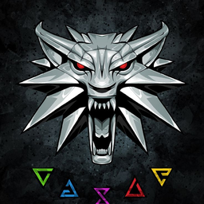

 <p align="center">
  
</p>

<h1 align="center">Nildo-Fullbright-Lite</h1>

<p align="center">
  A lightweight mod for <b>Lethal Company</b> (BepInEx 5) featuring just two functions:<br>
  <b>Night Vision</b> and <b>Fog Remover</b>.
</p>

---

## Features

| Feature | Description | Default Shortcut |
|---|---|---|
| **Night Vision** | Illuminates the area around the player. Adjustable intensity (0.2 to 10). | `F7` |
| **Fog Remover** | Removes HDRP fog and local fog volumes without modifying the game's original profiles. Fog returns to normal when disabled. | `F8` |
| **Menu** | A small, draggable window with both controls. | `Home` |

All settings and keybinds are saved to `BepInEx/config/nildomods.fullbrightlite.cfg`.

> Designed for **single-player / LAN** sessions with friends. In public lobbies, respect the server rules and other players.

## Installation (Players)

1. Install [r2modman](https://thunderstore.io/package/ebkr/r2modman/) and create a profile for **Lethal Company**.
2. Download the latest `.zip` file from **[Releases](../../releases)**.
3. In r2modman, go to **Settings → Profile → Import local mod** and select the `.zip` file.
4. Click **Start modded**.

This mod requires `BepInExPack`, which r2modman installs automatically.

## Building from Source

### Requirements

- [.NET SDK](https://dotnet.microsoft.com/download) 6.0 or later.
- **Lethal Company** installed (the game's DLLs are loaded from your installation; they are not included in this repository).

**BepInEx is already included in the repository** (`lib/BepInEx.dll`), so you do not need to point to the r2modman folder or have BepInEx installed to build the project.

### Step-by-Step

```bash
git clone https://github.com/SEU_USUARIO/NildoFullbrightLite.git
cd NildoFullbrightLite
dotnet build -c Release
```

The package is generated at **`dist/Nildo_Fullbright_Lite-<version>.zip`**, ready to be imported into r2modman.

DONT FORGET TO PUT BepInEx.dll in lib folder to run.
On Windows, you can also simply double-click `build.bat`.


### What If the Game Is Not Installed in the Default Location?

The project automatically searches for the Lethal Company installation directory in the following order:

1. `dotnet build -p:GameDir="D:\SteamLibrary\steamapps\common\Lethal Company"`
2. The `LocalPaths.props` file (copy `LocalPaths.props.example` and edit it; this file is excluded from Git).
3. The `LETHAL_COMPANY_DIR` environment variable.
4. The installed Steam directory (read from the Windows Registry).
5. `C:\Program Files (x86)\Steam\steamapps\common\Lethal Company`

If none of these methods locates the game, the build stops and displays an explanatory error message.

## Project Structure

```text
NildoFullbrightLite/
├── src/
│   ├── Plugin.cs           # BepInEx entry point, settings, and keybinds
│   ├── LiteBehaviour.cs    # Night Vision + menu (IMGUI)
│   └── FogRemover.cs       # Fog Remover (custom HDRP Volume)
├── package/                # ZIP contents (manifest, icon, README, plugins/)
├── lib/BepInEx.dll         # Build reference (LGPL-2.1, unmodified)
├── NildoFullbrightLite.csproj
├── LocalPaths.props.example
└── build.bat
```

## How It Works

- **Night Vision:** Uses the player's built-in night vision light (`PlayerControllerB.nightVision`), increases its intensity and range, and restores the original values when disabled.
- **Fog Remover:** Instead of modifying the game's fog profiles (which could leave fog stuck in an altered state), it creates its own global `Volume` with the highest priority and forces `Fog` to be disabled. Toggling the feature simply enables or disables this object.

## Versioning

When releasing a new version, update the version number in all three locations:

- `src/Plugin.cs` (`PluginInfo.VERSION`)
- `package/manifest.json`
- `NildoFullbrightLite.csproj` (`PluginVersion`)

## License

The code is licensed under [MIT](LICENSE). The `lib/BepInEx.dll` file is a third-party binary licensed under LGPL-2.1 and retains its original license.

Lethal Company is the property of Zeekerss. This project is not affiliated with or endorsed by Zeekerss.

---

<details>
<summary><b>English Summary</b></summary>

A lightweight BepInEx 5 mod for Lethal Company featuring **Night Vision** (F7) and **Fog Remover** (F8), with a menu accessible via `Home`.

Build with `dotnet build -c Release`. BepInEx is included in `lib/`, and the game directory is detected automatically. You can override the path using `-p:GameDir=...`, `LocalPaths.props`, or the `LETHAL_COMPANY_DIR` environment variable.

The r2modman-ready ZIP package is generated in `dist/`.

</details>